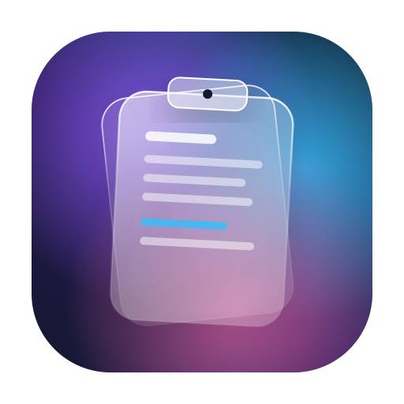
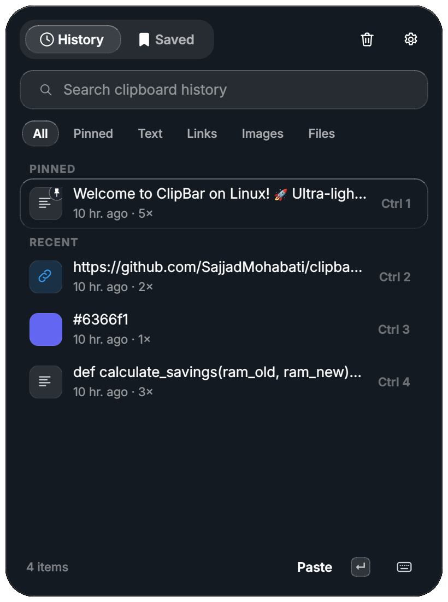

<p align="center">
  
</p>

<h1 align="center">ClipBar for Linux: Clipboard Manager That Never Loses What You Type</h1>

<p align="center">
  <b>A free, open-source clipboard history manager for Ubuntu, Debian, Fedora and Arch, with a Liquid Glass design.</b><br>
  <b>Drafts: recover text you typed and lost</b> · encrypted locked items · screenshots in your history · OCR search · instant paste
</p>

<p align="center">
  <a href="https://github.com/SajjadMohabati/clipbar-mac/releases/tag/linux-v1.0"></a>
  
  
  
  
  <a href="LICENSE"></a>
</p>

<p align="center">
  <a href="#install"><b>⬇️ Install</b></a>
  &nbsp;·&nbsp; <a href="#drafts-recover-text-you-typed-and-lost">Drafts</a>
  &nbsp;·&nbsp; <a href="#features">Features</a>
  &nbsp;·&nbsp; <a href="#wayland">Wayland</a>
  &nbsp;·&nbsp; <a href="#keyboard-shortcuts">Shortcuts</a>
  &nbsp;·&nbsp; <a href="#faq">FAQ</a>
</p>

<p align="center">
  
</p>

<p align="center"><a href="README.fa.md">🇮🇷 فارسی</a> &nbsp;·&nbsp; <a href="README.ar.md">🇸🇦 العربية</a> &nbsp;·&nbsp; <a href="../README.md">🍎 ClipBar for Mac</a></p>

<p align="center"><sub>Created by <a href="https://github.com/SajjadMohabati"><b>Sajjad Mohabati</b></a></sub></p>

---

ClipBar remembers everything you copy on Linux: text, links, colors, images and files. Press
`Ctrl+Shift+V`, pick an item and it's pasted where you were typing. It also keeps a copy of
**what you type** in other apps, so a reset form or a failed send never costs you your text.

## Drafts: recover text you typed and lost

You write a long message, press Send, and it's gone. The page reloaded, the session expired, the
app crashed, or you closed the tab by mistake.

**ClipBar Drafts saves what you type while you type it**, in any app that supports Linux
accessibility, even if you never copied it. Open ClipBar, go to the **Drafts** tab and paste it back.

| What went wrong | What ClipBar does |
| --- | --- |
| A web form reset or the page reloaded | Your text is in Drafts |
| "Message failed to send" and the box is empty | Your text is in Drafts |
| You closed the tab or the app quit | Your text is in Drafts |
| You selected everything and typed over it | The earlier version is in Drafts |

**How it works**

1. Turn it on once in **Settings → Drafts**.
2. Type anywhere: browsers, chat apps, email, forms, notes.
3. ClipBar keeps **one draft per message**. It updates as you type; when the field is emptied (sent or cleared), the full text stays in Drafts.
4. Lost something? Press `Ctrl+Shift+V`, open **Drafts** and press `Enter`.

**Private by design**

- **Not a keylogger.** ClipBar never listens to the keyboard. Once a second it asks the Linux accessibility service (AT-SPI) for the text of the focused field.
- **Never reads** password fields or search fields, and skips terminals, password managers and any app it can't identify. This works the same on X11 and Wayland.
- Card numbers and API keys are filtered out, drafts expire on their own, and nothing leaves your computer.
- **Off by default.** You choose the minimum length (30 characters), how long drafts are kept (12 hours) and how many (10).

## Features

### Clipboard history
- Remembers **text, links, colors, images and files**, with when you copied them.
- **Filters**: All · Pinned · Text · Links · Images · Files (`Tab` / `Shift+Tab`).
- **Instant search** across text, titles and the text recognized in images.
- **Pin** snippets to the top; copying the same thing again moves it up instead of duplicating it.
- **Auto cleanup** by age (1–365 days) and size (50–2,000 items); pinned items can be kept forever.

### Saved items and encrypted locking
- A separate **Saved** list for things you paste again and again: card number, address, email signature.
- **Give any saved item a title**, text or image. Titles are searchable.
- **Lock an item** and its value is encrypted with **AES-256-GCM**, using a key derived from your ClipBar password with **scrypt**. The password is never stored, so a wrong or empty password simply can't decrypt it.
- After unlocking, you have 30 seconds before ClipBar asks again; then the key is wiped from memory.

### Screenshots and OCR
- New screenshots in `~/Pictures/Screenshots` (or your Pictures folder) are **added to the history and copied to the clipboard**.
- **On-device text recognition** with Tesseract makes the text in images searchable.

### Paste and edit
- **Direct paste**: `Enter` pastes into the app you were using, `Alt+Enter` only copies.
- **`Ctrl+1`–`Ctrl+9`** paste the first nine items instantly.
- A full **editor** with character, word and line counts, color values (HEX, RGB, HSL) and image text.
- **One-click transforms**: UPPERCASE, lowercase, Capitalize, trim, remove empty lines, sort, deduplicate, join lines, format or minify JSON, Base64 and URL encode/decode.

### Privacy
- Ignores **private keys, API tokens** (GitHub, OpenAI, Stripe, AWS, Slack, Google…) and **credit card numbers** (Luhn check).
- **Pause capturing** from the tray menu.
- No account, no cloud, no analytics and no network requests.

## Install

### Ubuntu and Debian (recommended)

Download **`clipbar_1.0.0_all.deb`** from the
[latest Linux release](https://github.com/SajjadMohabati/clipbar-mac/releases/tag/linux-v1.0) and install it:

```bash
sudo apt install ./clipbar_1.0.0_all.deb
```

For Drafts, also install the accessibility packages:

```bash
sudo apt install python3-gi gir1.2-atspi-2.0 at-spi2-core
```

Then open **ClipBar** from your app menu, or run `clipbar`, and press `Ctrl+Shift+V`. To start it
with your desktop, turn on **Launch at login** in Settings → General.

### Fedora

```bash
sudo dnf install python3-pyqt6 python3-cryptography python3-gobject at-spi2-core xdotool tesseract
git clone https://github.com/SajjadMohabati/clipbar-mac.git
cd clipbar-mac/clipbar-linux && ./build.sh install
```

### Arch Linux and Manjaro

```bash
sudo pacman -S python-pyqt6 python-cryptography python-gobject at-spi2-core xdotool tesseract tesseract-data-eng
git clone https://github.com/SajjadMohabati/clipbar-mac.git
cd clipbar-mac/clipbar-linux && ./build.sh install
```

`./build.sh install` puts ClipBar in `~/.local` with a menu entry, using your system's Python
packages; `./build.sh uninstall` removes it. To try it without installing, run
`python3 -m clipbar.main` from the `clipbar-linux` folder.

| Package | Needed for |
| --- | --- |
| `python3-pyqt6`, `python3-pyqt6.qtsvg` | the app (required) |
| `python3-cryptography` | locked items (required) |
| `python3-gi`, `gir1.2-atspi-2.0`, `at-spi2-core` | Drafts |
| `xdotool` (X11), `wtype` or `ydotool` (Wayland) | direct paste |
| `tesseract-ocr` | text in images |
| `python3-pynput` | the global shortcut on X11 |

### Try it in Docker

On any computer with Docker, including a Mac, you can preview the Linux version in your browser:

```bash
cd clipbar-linux && ./run-docker.sh
```

Then open <http://localhost:6080/vnc.html?autoconnect=true&resize=scale>.

## Wayland

ClipBar works on GNOME and KDE Wayland sessions:

- **Clipboard history:** Wayland lets only the focused window read the clipboard, so ClipBar watches it through XWayland, where it's shared with every app. It does this automatically.
- **Shortcut:** Wayland doesn't let apps grab global keys. Add one in your desktop's keyboard settings (GNOME: *Settings → Keyboard → Custom Shortcuts*, KDE: *System Settings → Shortcuts*) with the command `clipbar --toggle` and the keys `Ctrl+Shift+V`.
- **Direct paste:** install `wtype` (Sway, Hyprland) or `ydotool` (GNOME, KDE). Without them, ClipBar copies the item and you press `Ctrl+V`.
- **Drafts:** works the same as on X11, through AT-SPI.

## Keyboard shortcuts

| Key | Action |
| --- | --- |
| `Ctrl+Shift+V` | Open ClipBar (change it in Settings) |
| `↑` `↓` | Move the selection |
| `Enter` | Paste the selected item |
| `Alt+Enter` | Copy without pasting |
| `Ctrl+1`–`Ctrl+9` | Paste item 1–9 |
| `Tab` / `Shift+Tab` | Next / previous filter |
| `Ctrl+[` / `Ctrl+]` | Previous / next tab (History, Drafts, Saved) |
| `Ctrl+S` | Move to Saved |
| `Ctrl+P` | Pin or unpin |
| `Ctrl+E` | View and edit |
| `Ctrl+Backspace` | Delete |
| `Ctrl+,` | Settings |
| `Esc` | Clear the search, then close |

From a terminal: `clipbar --toggle` opens or closes the panel, `clipbar --settings` opens Settings.

## FAQ

<details>
<summary><b>What is the best clipboard manager for Ubuntu?</b></summary>

ClipBar is a free, open-source clipboard manager for Ubuntu with history, search, pinned and saved
items, encrypted locked items, screenshots, OCR and Drafts, which recovers text you typed and lost.
Install the `.deb` from the [release page](https://github.com/SajjadMohabati/clipbar-mac/releases/tag/linux-v1.0).
</details>

<details>
<summary><b>How do I see my clipboard history on Linux?</b></summary>

Install ClipBar and press `Ctrl+Shift+V`. Everything you copied since ClipBar started is listed,
newest first, and you can search it, filter it by type and paste any item with `Enter`.
</details>

<details>
<summary><b>How do I recover text I typed that disappeared on Linux?</b></summary>

Turn on **Drafts** in ClipBar's settings. From then on, ClipBar keeps a copy of longer text while you
type it. If a form resets or a message fails to send, open the **Drafts** tab and paste it back.
Text typed before you turned Drafts on can't be recovered.
</details>

<details>
<summary><b>Is Drafts a keylogger?</b></summary>

No. ClipBar never reads the keyboard. It asks the accessibility service for the text of the focused
field once a second, never reads password or search fields, and skips terminals, password managers
and apps it can't identify. Drafts is off until you turn it on and stays on your computer.
</details>

<details>
<summary><b>How safe are locked items?</b></summary>

They're encrypted with AES-256-GCM. The key is derived from your ClipBar password with scrypt and is
never written to disk, so the encrypted file can't be opened without the password. If you forget
the password, locked items can't be recovered.
</details>

<details>
<summary><b>Does ClipBar work on Wayland?</b></summary>

Yes, on GNOME and KDE. See [Wayland](#wayland) for the global shortcut and direct paste setup.
</details>

<details>
<summary><b>Is ClipBar for Linux free?</b></summary>

Yes. It's free and open source under the MIT license, with no account, subscription or tracking.
</details>

## Your data

ClipBar follows the XDG directories:

- `~/.local/share/clipbar/history.json`: clipboard history
- `~/.local/share/clipbar/saved.json`: saved items (locked values are only in `vault.enc`, encrypted)
- `~/.local/share/clipbar/drafts.json`: drafts, if Drafts is on
- `~/.local/share/clipbar/images/`: copied images, stored once as PNG
- `~/.config/clipbar/settings.json`: preferences

To start over, quit ClipBar and delete these folders.

## Project layout

```
clipbar-linux/
  clipbar/
    main.py               entry point and single-instance control
    app.py                tray icon, panel, editor and settings windows
    clip_view.py          the clipboard panel
    editor_view.py        item viewer and editor
    settings_view.py      settings window
    store.py              history, saved items, drafts, persistence
    clipboard.py          clipboard I/O, secret detection, images, OCR
    vault.py              encrypted storage for locked items
    draft_watcher.py      Drafts, through AT-SPI
    screenshot_watcher.py picks up new screenshots
    main_thread.py        hands background work to the UI thread
    hotkey.py, settings.py, styles.py, transforms.py
  docker/                 the browser preview
  scripts/build-deb.sh    builds the .deb
  build.sh                install, uninstall and package
```

## Author

Created by **Sajjad Mohabati** · [github.com/SajjadMohabati](https://github.com/SajjadMohabati)

If ClipBar helps you, a ⭐️ on [GitHub](https://github.com/SajjadMohabati/clipbar-mac) helps other people find it.

## License

[MIT](LICENSE) © Sajjad Mohabati

<sub>Keywords: clipboard manager for Linux, Linux clipboard history, Ubuntu clipboard manager, Debian clipboard manager, Fedora clipboard manager, Arch Linux clipboard manager, Wayland clipboard manager, GNOME clipboard history, KDE clipboard manager, Qt clipboard app, recover lost typed text on Linux, restore unsent message, autosave what you type, draft recovery, copy paste history Linux, encrypted clipboard, screenshot to clipboard Linux, OCR clipboard, free open source clipboard manager.</sub>
